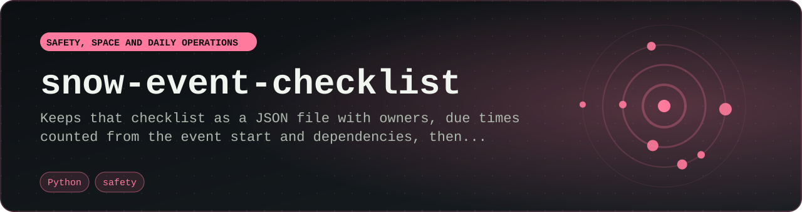
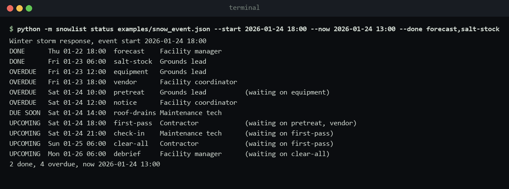

<p align="center"></p>

# snow-event-checklist

[](https://github.com/yassine2med/snow-event-checklist/actions/workflows/ci.yml)  

A snow or ice event is mostly preparation done on time: deicer counted, contractor confirmed, walkways pretreated, tenants told. This repo keeps that checklist as a JSON file with owners, due times counted from the event start and dependencies, then prints the timeline and tells you at any moment what is done, overdue or due soon.



## What it is for

Facility managers and grounds leads who plan for winter storms use it to turn "we have a plan somewhere" into a dated list. Run `plan` when the forecast changes to get exact times, and `status` during the event to see what is late and what is blocked behind it.

## Install

```
git clone https://github.com/yassine2med/snow-event-checklist
cd snow-event-checklist && pip install -r requirements.txt
```

## How to use

| I want to | Command |
|---|---|
| Check the checklist file | `PYTHONPATH=src python -m snowlist validate examples/snow_event.json` |
| Print the timeline for a start time | `PYTHONPATH=src python -m snowlist plan examples/snow_event.json --start "2026-01-24 18:00"` |
| See status at a given moment | `PYTHONPATH=src python -m snowlist status examples/snow_event.json --start "2026-01-24 18:00" --now "2026-01-24 13:00" --done forecast,salt-stock` |
| Keep finished ids in a file | add `--done-file done.json` (a JSON list of ids) |
| Show help | `PYTHONPATH=src python -m snowlist --help` |

Exit codes: 0 when fine, 1 when `validate` finds problems or `status` finds overdue tasks, 2 for unreadable input.

Example:

```
PYTHONPATH=src python -m snowlist status examples/snow_event.json --start "2026-01-24 18:00" --now "2026-01-24 13:00" --done forecast,salt-stock
```

Output:

```
Winter storm response, event start 2026-01-24 18:00
DONE      Thu 01-22 18:00  forecast    Facility manager    
DONE      Fri 01-23 06:00  salt-stock  Grounds lead        
OVERDUE   Fri 01-23 12:00  equipment   Grounds lead        
OVERDUE   Fri 01-23 18:00  vendor      Facility coordinator
OVERDUE   Sat 01-24 10:00  pretreat    Grounds lead          (waiting on equipment)
OVERDUE   Sat 01-24 12:00  notice      Facility coordinator
DUE SOON  Sat 01-24 14:00  roof-drains Maintenance tech    
UPCOMING  Sat 01-24 18:00  first-pass  Contractor            (waiting on pretreat, vendor)
UPCOMING  Sat 01-24 21:00  check-in    Maintenance tech      (waiting on first-pass)
UPCOMING  Sun 01-25 06:00  clear-all   Contractor            (waiting on first-pass)
UPCOMING  Mon 01-26 06:00  debrief     Facility manager      (waiting on clear-all)
2 done, 4 overdue, now 2026-01-24 13:00
```

The timeline:

```
Winter storm response, event start 2026-01-24 18:00
Thu 01-22 18:00  T-48h  Facility manager     Confirm forecast and notify the response team
Fri 01-23 06:00  T-36h  Grounds lead         Count deicer and fill spreaders
Fri 01-23 12:00  T-30h  Grounds lead         Test plows, blowers and shovels
Fri 01-23 18:00  T-24h  Facility coordinator Confirm contractor on call and arrival times
Sat 01-24 10:00  T-8h   Grounds lead         Pretreat walkways, ramps and entrances
Sat 01-24 12:00  T-6h   Facility coordinator Send closure or delay notice to tenants
Sat 01-24 14:00  T-4h   Maintenance tech     Check roof drains and building entrances for ice dams
Sat 01-24 18:00  T+0h   Contractor           First plow and salt pass at event start
Sat 01-24 21:00  T+3h   Maintenance tech     Hourly condition check of exits and ramps
Sun 01-25 06:00  T+12h  Contractor           Clear all accessible routes and parking
Mon 01-26 06:00  T+36h  Facility manager     Log damage, hours and salt used; debrief the team
11 tasks
```

A broken checklist is caught by `validate`:

```
duplicate id 'c'
b: due before its dependency 'a'
c: owner is empty
c: depends on unknown task 'ghost'
circular dependency: a -> b -> a
4 tasks checked, 5 problem(s)
```

Run the tests with `python -m pytest -q`.

## How it works

1. Each task has an `id`, `title`, `owner`, `due_hours` (negative before the event start, positive after) and an optional `depends_on` list.
2. `validate` checks for duplicate ids, empty owners or titles, unknown dependencies, circular dependencies and tasks due before something they depend on.
3. `plan` adds `due_hours` to the start time and sorts the tasks.
4. `status` labels each task DONE, OVERDUE (due time passed), DUE SOON (within 2 hours) or UPCOMING, and shows which unfinished dependencies still block it.

## Limits

- The example checklist is a starting point, not a standard. Edit tasks, owners and hours to match your site and contracts.
- It tracks times you give it. It does not read weather feeds or send alerts.
- Marking tasks done is manual, through `--done` or `--done-file`.

## License

MIT. Yassine Emhamed, 2026.
